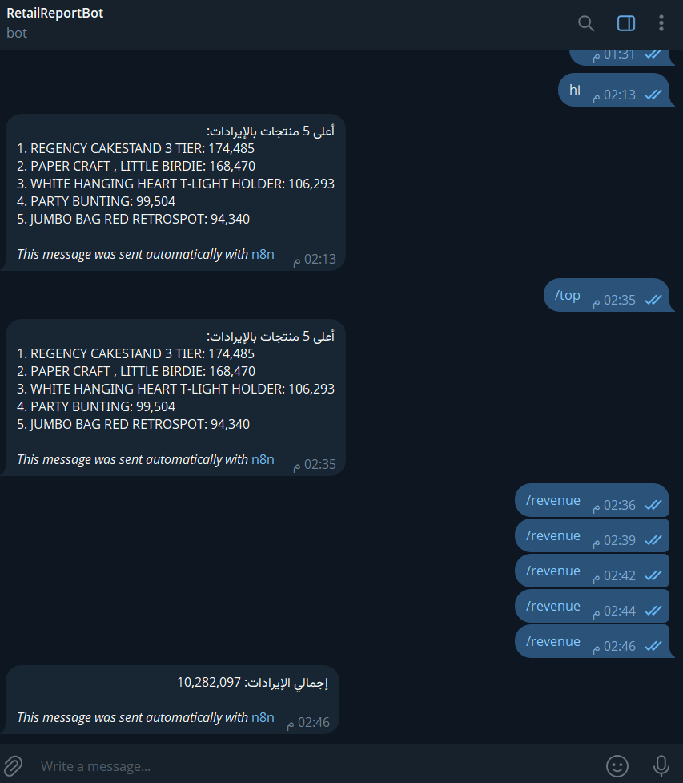
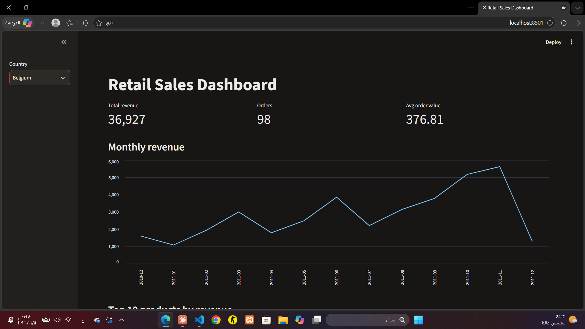

# Retail Sales Reporting Bot

An end-to-end automation project that analyzes retail sales data and
delivers reports through a Telegram bot.

## What it does
- Loads the Online Retail dataset into a SQLite database
- Runs SQL + pandas analysis (top products, total revenue)
- Exposes results through a FastAPI REST API (protected by an API key)
- Uses n8n to receive Telegram commands and reply with live reports

## Architecture
Telegram → n8n → ngrok → FastAPI → SQLite (retail.db)

## Tech Stack
Python, pandas, SQL (SQLite), FastAPI, Uvicorn, n8n, ngrok, Telegram Bot API

## Bot Commands
| Command    | Description                      |
|------------|----------------------------------|
| `/top`     | Top 5 products by revenue        |
| `/revenue` | Total revenue                    |
   
   
   
  
## Dashboard

An interactive Streamlit dashboard with a country filter, KPIs, monthly revenue, and top products.

Run it with: `streamlit run dashboard.py`
## Project Structure
- `load_db.py`: loads the data into SQLite
- `queries.py`: SQL queries for the analysis
- `api.py`: FastAPI endpoints (`/report`, `/revenue`)
- `report.py`: generates reports

## How to run
1. Create a virtual environment and install dependencies:
   `pip install pandas fastapi uvicorn`
2. Set the API key:
   `$env:REPORT_API_KEY = "your-secret-key"`
3. Start the API:
   `uvicorn api:app --port 8000`
4. Expose it with `ngrok http 8000` and point the n8n workflow to the URL.

## Key Insights
- Top product by revenue: REGENCY CAKESTAND 3 TIER
- Total revenue: ~10.3M

## Future Improvements
- Deploy the API on a VPS
- Add `/countries` and `/help` commands